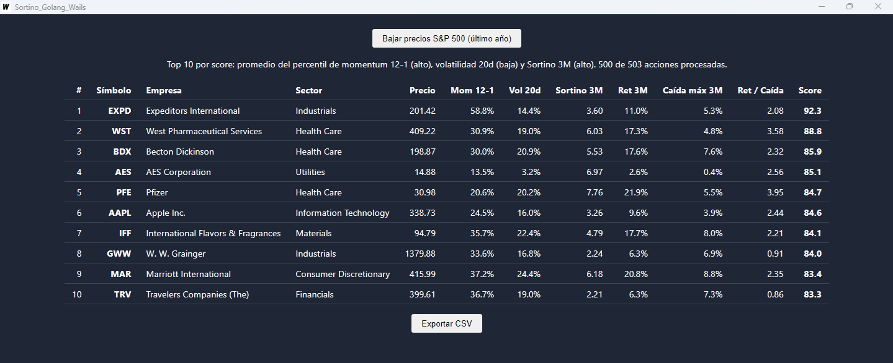

# Sortino_Golang_Wails — ejemplo de estudio con Wails v3 + Go + Svelte

App de escritorio para Windows que baja un año de precios de las acciones del
S&P 500 desde Yahoo Finance, calcula indicadores de riesgo/retorno y muestra
las 10 mejores en una tabla, con exportación a CSV.



Sirve como ejemplo de una app Wails pequeña pero ordenada: lógica separada de
la interfaz, concurrencia en Go, eventos del backend al frontend, pruebas y
un frontend por componentes.

## Estructura

```
main.go                arranque de la app y ventana (solo cableado)
stocks_service.go      servicio expuesto al frontend (puente Go <-> JavaScript)
internal/
  market/              datos externos: lista del S&P 500 y precios de Yahoo
  ranking/             indicadores y puntaje (funciones puras)
  export/              escritura del CSV
frontend/
  index.html           página base
  public/style.css     estilos globales
  src/main.js          punto de entrada
  src/App.svelte       pantalla principal (estado + llamadas a Go)
  src/lib/             StockTable.svelte (tabla) y format.js (formatos)
  bindings/            generado por Wails: no se edita a mano
build/                 configuración de empaquetado para Windows
```

**Regla de dependencias:** `main` → `stocks_service` → `internal/*`. Los
paquetes de `internal/` no conocen a Wails, por eso se prueban sin abrir la
app.

## Cómo fluyen los datos

```
Botón (Svelte) ──Backend.TopStocks()──▶ StockService (Go)
                                          │  market.Prices ×503 (10 en paralelo)
                                          │  ranking.Analyze / ranking.Rank
Tabla (Svelte) ◀────── Report ────────────┘
Contador ◀────── evento "progress" ───────┘
```

## Indicadores

| Indicador | Qué mide | Mejor |
|---|---|---|
| Momentum 12-1 | Retorno de 12 meses sin el último mes | alto |
| Vol 20d | Volatilidad anualizada, últimos 20 días | baja |
| Sortino 3M | Retorno/riesgo a la baja, últimos 3 meses | alto |
| Ret / Caída | Retorno 3M dividido por la caída máxima | alto (informativo) |

**Score** = promedio del percentil de Momentum, Vol 20d y Sortino (0–100).
No predice el futuro: es un filtro para ordenar acciones, no una
recomendación de inversión.

## Comandos

Requisitos: Go, Node.js y la CLI `wails3`
(`go install github.com/wailsapp/wails/v3/cmd/wails3@latest`).

```
wails3 dev        desarrollo con recarga en vivo
wails3 build      compila a bin\Sortino_Golang_Wails.exe
go test ./...     pruebas del backend
```
